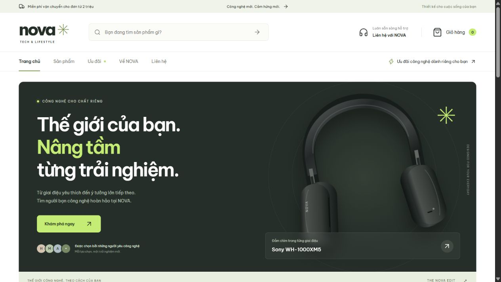

# NOVA — Website bán hàng điện tử

Website thực hành môn **Lập trình Web**, xây dựng bằng **ReactJS + Vite**, CSS thuần và **React Router**. Giao diện tiếng Việt, tương thích máy tính và điện thoại.

**Repository nộp bài:** https://github.com/Eyblcat12/thlaptrinhweb



[Xem toàn bộ trang chủ](docs/home-preview.png) · [Giao diện điện thoại](docs/mobile-preview.png) · [Kết quả kiểm tra](docs/TESTING.md)

## Chạy project

Cài Node.js 22.12 trở lên (khuyến nghị Node.js 24 LTS), sau đó:

```bash
npm ci
npm run dev
```

Mở **http://localhost:3000**. Vite hiển thị địa chỉ và cổng thực tế trong terminal nếu cổng 3000 đã được sử dụng.

```bash
npm test          # Kiểm tra xử lý giỏ hàng, phí vận chuyển và mã giảm giá
npm run build    # Build production vào dist/
npm run preview  # Xem bản production tại cổng 3000
```

## Đáp ứng yêu cầu bài tập

| Yêu cầu                    | Phần thực hiện                                            |
| -------------------------- | --------------------------------------------------------- |
| React với Vite/Next.js     | React + Vite, khởi tạo tại `src/main.jsx`                 |
| HTML giao diện trang chủ   | JSX có semantic HTML trong `src/pages/Home.jsx`           |
| CSS riêng                  | `src/styles.css`, responsive với media queries            |
| Source trên GitHub         | Repository ở đầu tài liệu                                 |
| Nhiều pages/components     | Thư mục `src/pages/`, `src/components/`                   |
| Tích hợp React Router      | `BrowserRouter`, `Routes`, `Route`, `Link`, `NavLink`     |
| Điều hướng qua menu và URL | Routes trong `src/App.jsx`, fallback SPA do Vite cung cấp |

## Các trang và đường dẫn

| Đường dẫn                         | Nội dung                                           |
| --------------------------------- | -------------------------------------------------- |
| `/`                               | Trang chủ, danh mục, sản phẩm nổi bật, banner      |
| `/products`                       | Danh sách 12 sản phẩm, tìm kiếm, lọc và sắp xếp    |
| `/products?category=phone`        | Lọc điện thoại qua URL                             |
| `/products?q=sony&sort=price-asc` | Tìm kiếm và sắp xếp qua URL                        |
| `/products/sony-wh-1000xm5`       | Chi tiết sản phẩm theo route động                  |
| `/deals`                          | Sản phẩm giảm từ 25%                               |
| `/about-us`                       | Giới thiệu NOVA                                    |
| `/about-us#policies`              | Chính sách minh họa và FAQ                         |
| `/contact`                        | Form liên hệ có kiểm tra dữ liệu                   |
| `/cart`                           | Giỏ hàng, số lượng, xóa sản phẩm, mã giảm giá      |
| `/checkout`                       | Form đặt hàng mô phỏng (cần có sản phẩm trong giỏ) |
| `/order-success`                  | Kết quả đơn mô phỏng đã tạo                        |
| Đường dẫn khác                    | Trang 404                                          |

Ví dụ: mở thẳng **http://localhost:3000/about-us**, bấm F5 hoặc click **Về NOVA** trên menu đều hiển thị trang giới thiệu. `BrowserRouter` sử dụng History API, không cần dấu `#` trong đường dẫn.

## Chức năng

- Tìm sản phẩm theo tên, thương hiệu và danh mục; hỗ trợ tìm tiếng Việt không dấu.
- Lọc danh mục, thương hiệu, khoảng giá; sắp xếp theo mức giá, độ phổ biến, giảm giá.
- Trạng thái bộ lọc nằm trong URL, hỗ trợ nút Back/Forward của trình duyệt.
- Chi tiết sản phẩm, thông số, giá, sản phẩm gợi ý.
- Thêm/xóa hàng, sửa số lượng (tối đa 10 mỗi loại); lưu giỏ hàng bằng `localStorage`.
- Mã **NOVA10** giảm 10%, tối đa 500.000đ.
- Phí vận chuyển minh họa 30.000đ; miễn phí từ 2.000.000đ trước giảm giá.
- Đặt hàng COD mô phỏng với kiểm tra các trường bắt buộc, email và số điện thoại.
- Form liên hệ và nhận tin có kiểm tra dữ liệu, thông báo hoàn thành minh họa.
- Menu điện thoại, trạng thái rỗng, trang 404, focus bàn phím và hỗ trợ giảm chuyển động.

## Cấu trúc

```text
public/
  images/               # 6 hình SVG minh họa tự thiết kế, không phụ thuộc ảnh từ xa
  favicon.svg
  _redirects            # SPA fallback cho Netlify/Cloudflare Pages
src/
  components/           # Layout, ProductCard, Icon, Breadcrumb, OrderSummary
  context/ShopContext.jsx
  data/products.js       # Dữ liệu sản phẩm minh họa
  lib/cart.js            # Xử lý giỏ hàng, tính tổng tiền
  pages/                 # Home, Products, ProductDetail, Cart, Checkout, About, Contact...
  App.jsx                # Khai báo routes
  main.jsx               # Khởi tạo React, BrowserRouter, ShopProvider
  styles.css             # Giao diện và responsive
tests/cart.test.js
vercel.json              # SPA fallback cho Vercel
.github/workflows/ci.yml  # Tự động chạy test và build
```

## Thử nghiệm nhanh

1. Mở trang chủ, click **Về NOVA**, kiểm tra URL `/about-us` và tải lại trang.
2. Mở **Sản phẩm**, thử tìm `dien thoai`, chọn thương hiệu, khoảng giá và cách sắp xếp.
3. Mở một sản phẩm và thêm vào giỏ. Tải lại trang để kiểm tra giỏ vẫn được lưu.
4. Trong giỏ, tăng/giảm số lượng và nhập **NOVA10** để kiểm tra tổng tiền.
5. Đi tới đặt hàng, thử gửi form trống để xem kiểm tra bắt buộc. Điền dữ liệu giả hợp lệ và xác nhận mô phỏng.
6. Kiểm tra trang thành công và giỏ hàng đã được dọn trống.
7. Thu nhỏ trình duyệt để kiểm tra menu và bố cục điện thoại.

## Build và triển khai

Vite dev server và preview server tự xử lý SPA fallback, nên mở URL trực tiếp hoạt động ngay trên localhost. Khi triển khai lên Vercel hoặc Netlify, cấu hình kèm theo chuyển các đường dẫn ứng dụng về `index.html`.

Nếu tự host trên Nginx, cần cấu hình `try_files $uri $uri/ /index.html;`. GitHub repository là nơi lưu source, **không tự chạy website**. GitHub Pages cần thiết lập base path và SPA fallback riêng, vì project hiện sử dụng URL từ gốc domain.

## Giới hạn của bản demo

Đây là ứng dụng frontend cho bài tập, **không có backend, xác thực, thanh toán hoặc giao dịch thực tế**. Giá, tồn kho, đánh giá, hình sản phẩm và chính sách đều là dữ liệu minh họa; tên thương hiệu dùng cho mục đích học tập. Hình SVG đại diện nhóm thiết bị, không phải ảnh sản phẩm chính hãng.

Thông tin từ form giao hàng, liên hệ, nhận tin không được gửi tới máy chủ. Chỉ giỏ hàng được lưu trong `localStorage`; mã ưu đãi, mã đơn, số lượng và tổng tiền demo được lưu trong `sessionStorage`. Việc ghi lưu trữ bị chặn sẽ không ngăn người dùng tiếp tục thao tác trong phiên hiện tại.

Font Be Vietnam Pro tải từ Google Fonts, có font Arial dự phòng khi offline. Icon dùng Lucide. Các hình SVG của project được phân phối cùng source theo LICENSE.

## Tài liệu tham khảo

- [React](https://react.dev/)
- [Vite](https://vite.dev/guide/)
- [React Router — Declarative Mode](https://reactrouter.com/start/declarative/installation)
- [Lucide](https://lucide.dev/)

Giữ nguyên giấy phép MIT sẵn có của repository trong file `LICENSE`.
